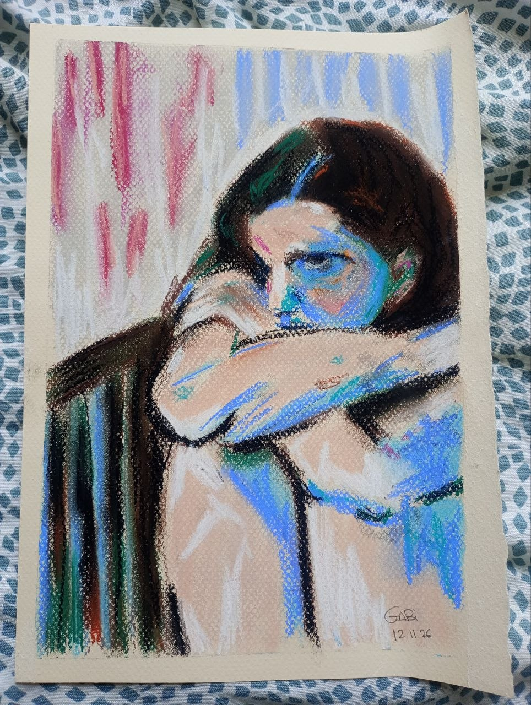

Dicen que aprender cualquier habilidad nueva, o introducir cualquier cambio consciente en nuestro comportamiento, tiene cuatro fases:

- Incompetencia inconsciente, antes de empezar: se te da mal, pero aún no sabes que se te da mal
- Incompetencia consciente, al comenzar a introducir el cambio/habilidad: se te da mal, y eres capaz de ver lo mal que se te da en función de lo que sabes que podría ser
- Competencia consciente: se te empieza a dar mejor, mientras que estés prestándole atención. Si bajas la guardia, vuelves a lo de antes.
- Competencia inconsciente: te sale bien sin darte cuenta

Esto se aplica cuando aprendemos un idioma nuevo, cuando empezamos a poner límites, cuando tomamos la determinación de "la próxima vez que pase X, haré Y", o cuando dejamos de coleccionar capturas de pantalla de cerámica preciosa en Instagram, empezamos a hacer cerámica horrenda, y durante una temporada tenemos que hacer cerámica horrenda mientras sostenemos el dolor de saber lo bonita que podría ser.

Porque, de todas estas fases, la más dolorosa es la segunda. Yo soy una perfeccionista irredenta, lo cual no significa que alguna vez haya hecho algo perfecto, sino que todo lo que he hecho alguna vez me parece, de alguna forma, chapucero. Esto ha significado abandonar muchas cosas en la fase de "incompetencia consciente", cuando dejan de ser novedosas y empiezan a volverse complicadas, porque mi cabeza y mi corazoncito no siempre pueden soportar el bombardeo interior de comparar lo que estoy haciendo con lo que proyecto que podría ser.

*Traducción libre: hacer algo mal es el primer paso hacia hacer algo medio bien*

---

Estoy tratando, en este sentido, de hacer las cosas de otra manera, lo cual es su propio proceso, bastante meta: ver cómo aún se me da mal aceptar que hay cosas que aún se me dan mal, y aprender a quedarme en la incomodidad de aprender a quedarme en la incomodidad de esa diferencia. Entre el segundo paso y el tercero, a veces me doy cuenta de que estoy siendo demasiado exigente pero no puedo hacer otra cosa (e insisto o abandono), y a veces me doy cuenta y hago otra cosa, como permanecer en esa incomodidad, ahora mismo, con mucho esfuerzo.

Ayer, en clase de pintura, dibujé a esta muchacha enfadadísima.

Es mi segundo dibujo con pastel, y lo hice en dos horas (excusas obligatorias para poder seguir adelante) y, aunque en su mayoría se parece bastante al original, no quiero poner aquí el original para no tener que pensar en que la ceja y el ojo, que es donde está toda la tensión del dibujo, no se parecen tanto como yo querría. Imposible considerar que el original con el que lo estoy comparando puede estar hecho por alguien que lleve 20 años pintando, o que esté hecho con IA, o whatever. La ciénaga intermedia consiste en aguantar esta incomodidad y pintar otro cuadro, y otro, y otro.

Creo que esto es parecido a lo que en Gestalt llaman el vacío fértil, cuando las certezas de una orilla se han ido pero aún no ves la otra orilla que está por venir. Supongo que una ciénaga también puede verse como un suelo rico, denso, lleno de nutrientes… pero desde aquí solo se ve el vapor hediondo.

Escribir aquí —como he intentado tantas otras veces, en tantos otros sitios— supone, a su vez, ese esfuerzo: el de imaginar cómo sería tener un lugar donde expresarme sin miedo y con cierta capacidad, mientras soporto la incomodidad de ver que aún estoy muy lejos de poder hacerlo, durante el tiempo que haga falta hasta que la diferencia se acorte.